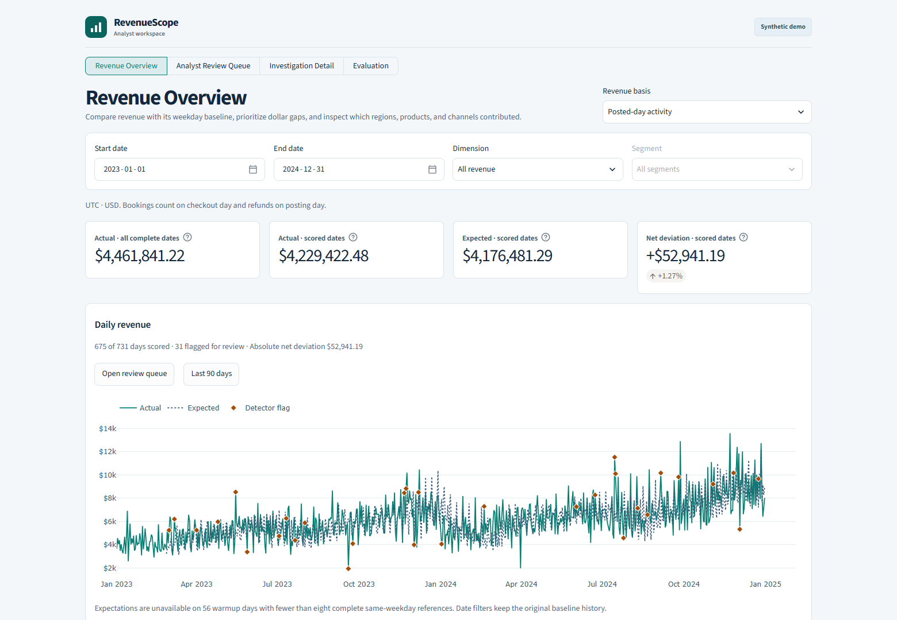

# RevenueScope

**Revenue investigation for e-commerce analytics teams.** RevenueScope gives analysts a way to compare daily revenue with a weekday baseline, prioritize material deviations, and inspect how the gap breaks down by region, product, or channel. The Streamlit workspace uses one reproducible synthetic merchant and has no upload or sign-in flow.



## Run the demo

Use Python 3.12 and start in the root of the prepared release tree. On Windows:

```powershell
py -3.12 -m venv .venv
.\.venv\Scripts\python.exe -m pip install -r requirements.txt
.\.venv\Scripts\python.exe -m streamlit run demo_app.py --server.address 127.0.0.1
```

On macOS or Linux, create the environment with `python3.12 -m venv .venv` and use `.venv/bin/python` in the remaining commands. Open the URL printed by Streamlit. The public demo reads the bundled synthetic DuckDB snapshot and display evidence from `demo_assets/`. Launching it requires no credentials, external data service, generation run, or detector training.

## Explore the workspace

1. **Revenue Overview.** Compare actual and expected posted-day activity on comparable scored dates. The complete-date actual is shown separately. Select a date range or view actuals for a region, product, or channel.
2. **Analyst Review Queue.** Sort flags by absolute dollar deviation, filter by direction, and open a date. A flag starts an investigation.
3. **Investigation Detail.** Read the actual, expected, and signed gap in exact cents. Segment allocations reconcile to the overall difference. Earlier daily revenue provides context for the flag.
4. **Evaluation.** Compare the original and locked policy on the same held-out seeds. Event precision, event recall, date-level metrics, and unmatched alerts have separate definitions.

## Revenue and evaluation

The default **posted-day activity** view recognizes booking value on checkout day and subtracts refunds when they post. The separate **retrospective order-day** view assigns known refunds to the original purchase date at the snapshot cutoff. Both use UTC. Report dates are inclusive in the UI, while the underlying time windows use exclusive end boundaries. Monetary values reconcile in integer USD cents.

The synthetic demo spans **731 dates** from January 2023 through December 2024. Posted-day activity reconciles to **$4,461,841.22**, with **675 scored dates**, **56 warmup dates**, and **31 flagged dates**. These snapshot flags are distinct from the held-out benchmark. On the locked posted-day benchmark, **7 of 15 eligible events** were detected (**46.67% event recall**), and **7 of 88 alert episodes** matched (**7.95% event precision**). The benchmark repeats five simulated event types across three held-out seeds. Unmatched dates measure review workload under those matching rules. Production performance has not been established.

RevenueScope is designed for analyst investigation. The low precision, synthetic status assumptions, sparse segments, and single-merchant dataset limit operational use. Segment contributions locate portions of the gap under the chosen allocation. Confirming a cause requires independent evidence.

## Reproduce the analysis

The source tree includes the generator, DuckDB SQL, locked screening policy, benchmark replay, and automated tests. Run developer commands in a separate working copy of the release tree. Use the test requirements to install the runtime and test dependencies into the same Python 3.12 environment.

```text
python -m pip install -r requirements-test.txt
python -m pytest
python -m revenuescope generate --output data/rebuilt
python -m revenuescope verify --database data/rebuilt/revenuescope.duckdb --manifest data/rebuilt/verification_manifest.json --replay
python -m revenuescope.benchmark tune --output output/replay-development.json
python -m revenuescope.benchmark evaluate --lock output/replay-development.json --output output/replay-heldout.json
```

These commands produce developer-only event labels and benchmark evidence. Keep their output in the ignored `data/rebuilt/` and `output/` directories. The demo entrypoint reads the bundled snapshot and curated display evidence. See the [case study](docs/case_study.md) for the model and validation design and the [deployment guide](docs/deployment.md) for release packaging and host checks.

## License decision

MIT is the proposed license for the original project code and documentation. It permits broad reuse while retaining the copyright and permission notice. Confirm the license, copyright holder, and year before adding a root `LICENSE` and publishing. [MIT license text](https://opensource.org/license/mit)
